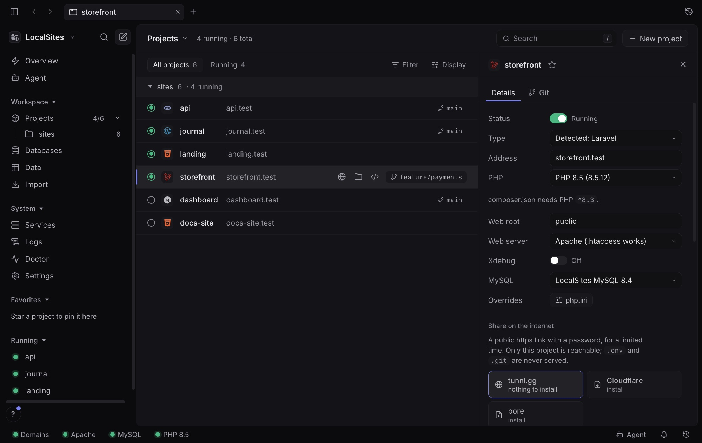
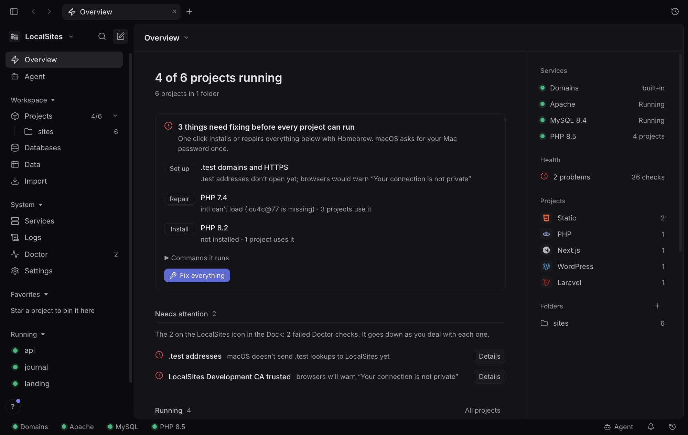
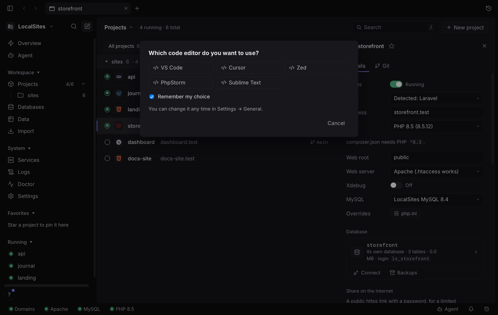
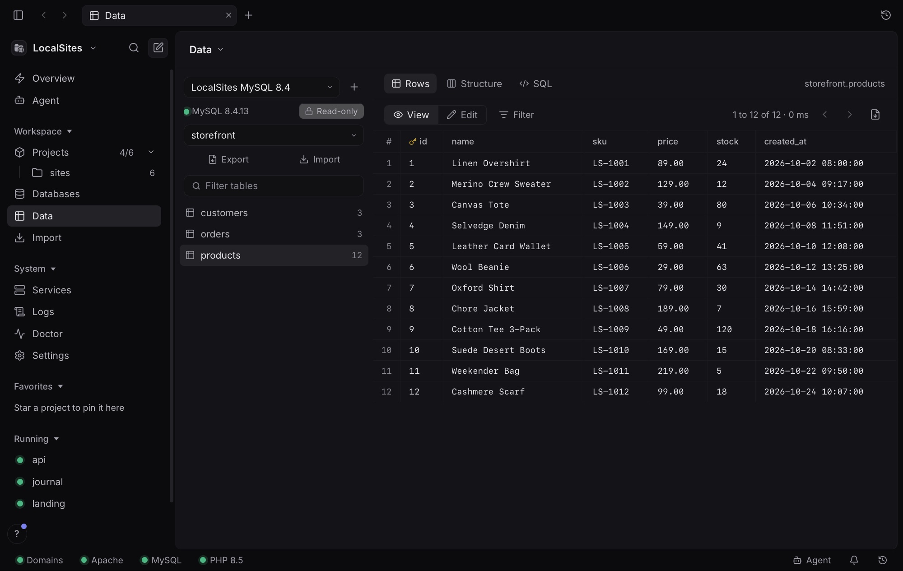
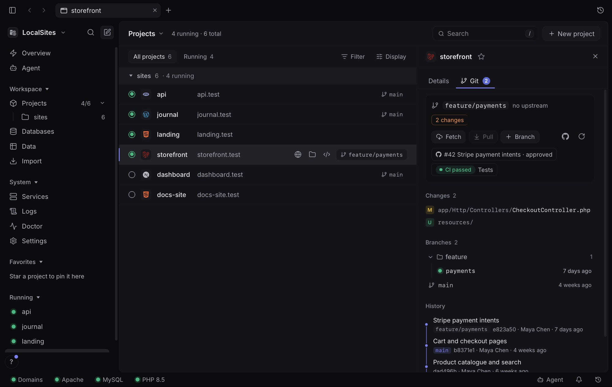
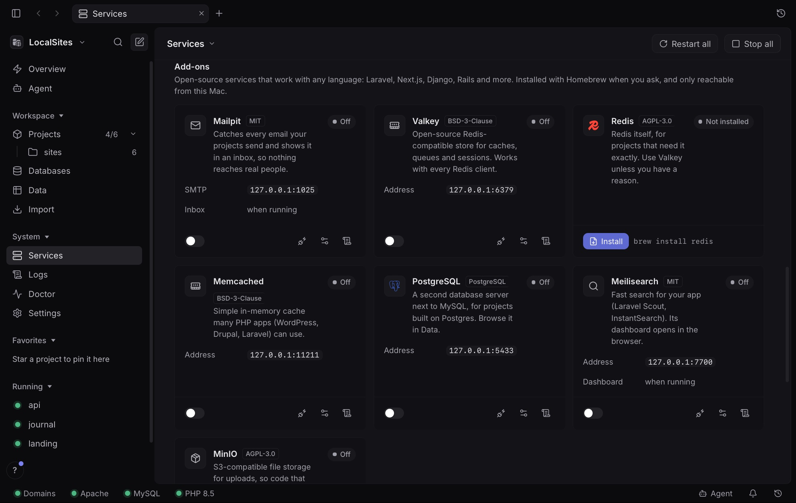
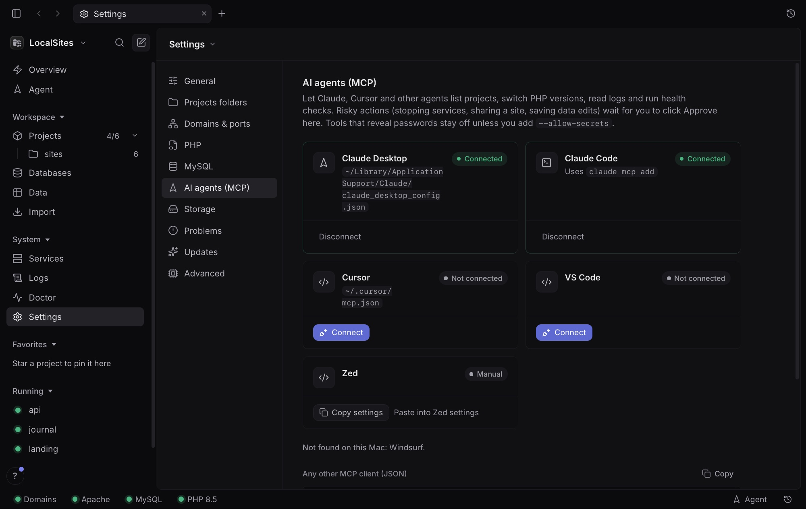
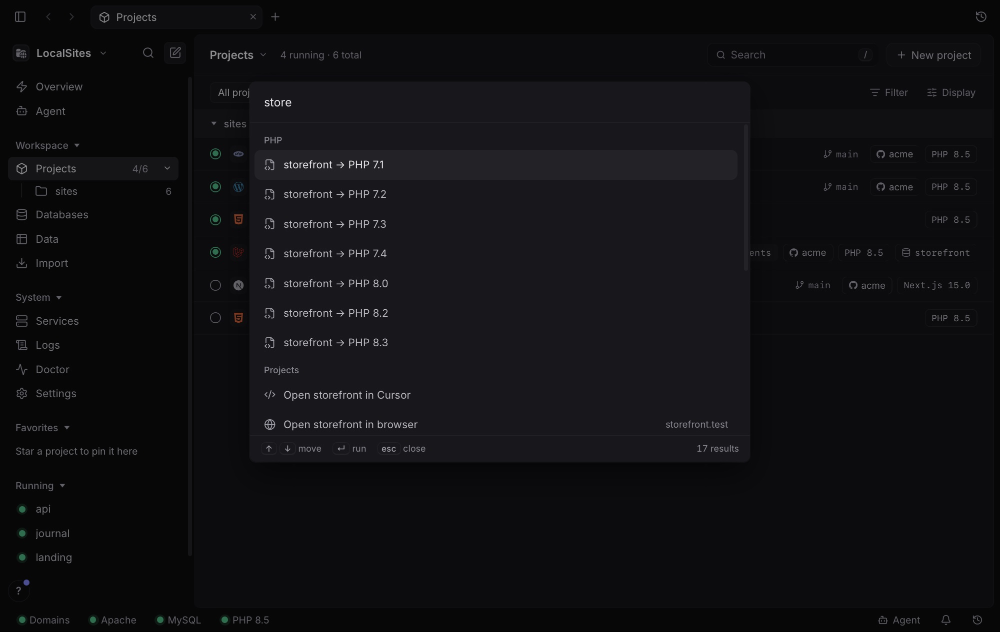
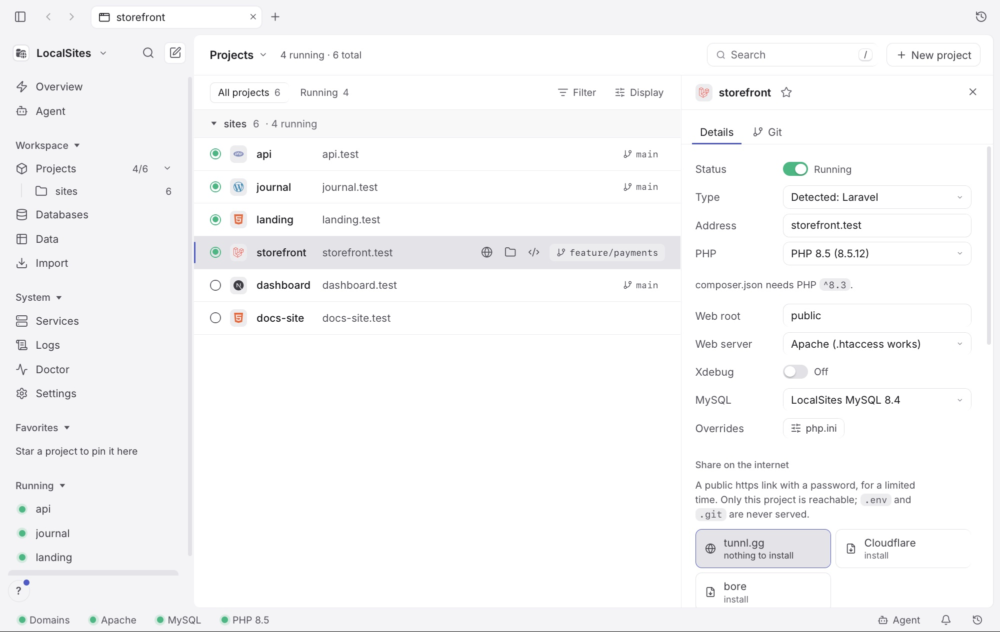

<div align="center">


# LocalSites

**A free, open-source alternative to MAMP PRO, Laravel Herd and XAMPP for macOS and Linux (beta), with an MCP server for AI coding agents.**

Every project folder gets a real `https://name.test` address. PHP, MySQL, Node, Laravel, WordPress and Next.js
work out of the box. A 22 MB native app, a CLI and an MCP server share one engine, so you and your AI coding agent
run the same local stack.

[](LICENSE)
[](#install)
[](#linux-beta)
[](go.mod)
[](https://github.com/itismowgli/localsites/actions/workflows/ci.yml)
[](#ai-agents-mcp)
[](CONTRIBUTING.md)

[**Download**](https://github.com/itismowgli/localsites/releases/latest) ·
[Website](https://itismowgli.github.io/localsites/) ·
[Features](#features) ·
[Switching](#switching-from-another-tool) ·
[CLI](#cli) ·
[AI agents](#ai-agents-mcp) ·
[Security](#security)

<br>



</div>

---

## Why LocalSites

LocalSites is free and open source under the MIT licence, with no accounts, trials, upsells or telemetry. Problem
reports stay off until you turn them on, and you see each report before it's sent.

Drop a folder in `~/Sites` and open `https://shop.test`. Each project gets a real certificate, its own PHP pool and
its own database login, and you never type a port number.

Claude, Cursor, VS Code and Devin Desktop (formerly Windsurf) connect over MCP in one click. Agents can list projects, switch PHP, read logs
and run health checks, and anything risky waits for you to click Approve.

The app is 22 MB because it uses the system web view. At idle the background service uses about 24 MB of memory and
does nothing until something changes. MySQL sleeps when nothing needs it.

## Features

### Every project, every stack

| | |
|---|---|
| **HTTPS for every folder** | `https://<folder>.test`, no port numbers. Uses Laravel Valet if you have it, or a built-in proxy and DNS server |
| **PHP 7.1 → 8.5 per project** | Switch in one click. Laravel picks the version its `composer.json` asks for |
| **Apache or Nginx** | Full `.htaccess` support on Apache; Nginx with pretty-URL fallback. One isolated PHP-FPM pool per project |
| **Xdebug per project** | Turn it on for the project you're debugging; everything else stays fast. Your `php.ini` is never touched |
| **Laravel, WordPress, PHP, static** | Detected automatically, with the right web root (`public/` for Laravel) |
| **Next.js, Node, Docker, anything** | Runs your dev server (npm, pnpm, yarn or bun; `.nvmrc` respected) behind `https://name.test`, restarts it if it crashes. Or any command: `python manage.py runserver {port}`, `docker compose up`, `rails s -p {port}` |
| **Many folders, many git accounts** | Add every projects folder you use. Group folders (one per GitHub/GitLab/Bitbucket account) are found automatically |
| **Per-project settings** | Environment variables, `php.ini` overrides, web root, domain, or commit a `localsites.yaml` to share them with your team |
| **Your editor, your terminal** | Open any project in the editor or terminal you choose (VS Code, Cursor, Zed, PhpStorm, Sublime, iTerm2, Ghostty, kitty and more). LocalSites asks once and never guesses |
| **Its database, one click away** | Each project shows the database it uses (from LocalSites, its `.env` or WordPress' `wp-config.php`) and opens it in the data browser in one click |
| **Rename, hide or trash** | Rename a project folder and its settings and address follow; hide it from LocalSites; or move it to the Trash. Its database is never touched |

### Sets itself up



Overview lists what's missing or broken (Apache, MySQL, the PHP versions your projects use, `.test` domains and
HTTPS) and **Fix everything** sorts it out in the background, with at most one password prompt. The first time you
open a project in an editor, LocalSites asks which one you use instead of guessing:



### Databases, with a real data browser



- **MySQL 8.4 LTS** with **one login per project** (no shared `root`), passwords in the macOS Keychain (or your Linux desktop keyring)
- **Data browser** for LocalSites MySQL, MAMP's MySQL, any MySQL/MariaDB (with SSH tunnels), PostgreSQL and SQLite:
  tables, rows, structure, SQL with autocomplete and history
- **Safe by default.** Every connection starts read-only. In Edit mode changes are staged, you review the exact
  SQL, and everything is saved in one transaction
- **Filters you can read.** Build a filter from rules (and, or, groups inside groups) with inputs that fit each
  column, undo with <kbd>⌘</kbd><kbd>Z</kbd>, and see it as SQL, JSON or plain English. Values are always passed
  as parameters
- **Database tools.** Export (`.sql`, `.sql.gz`; full, structure or data), import (`.sql`, `.sql.gz`, `.zip`),
  backups and restore, duplicate, empty, delete. Anything that removes data is backed up first
- **Open in TablePlus or Sequel Ace** with the details filled in. **Adminer** at `https://adminer.test` (a
  checked copy, downloaded on first use)

### Git built in



Branch, changed files, ahead/behind, fetch, fast-forward pull, branch tree, switch and create branches (refused
when you have uncommitted work), and the open **GitHub pull request and CI status** for your branch. The history
is a **commit graph**: hover a commit for its message, author, branches, tags and changed lines.

### Add-ons when you need them



**Mailpit** (catches every email, `mail.test`), **Valkey / Redis**, **Memcached**, **PostgreSQL**,
**Meilisearch** and **MinIO** (S3-compatible). One-click install with Homebrew (you see the command first),
ready-to-paste connection settings for Laravel, Next.js, Django, Rails and more, and all of it reachable only
from your Mac.

### Share a site on the internet

Show a client or test a webhook: share any running project with no account. **tunnl.gg** works right away,
since it only needs the `ssh` that comes with macOS and Linux. A **Cloudflare quick tunnel** or **bore** are one
click to install. Each share has its own gateway that reaches only that one site. It has a password
by default and limits wrong guesses, never serves `.env` or `.git`, and stops by itself after 15 minutes to 24 hours.

### AI agents (MCP)



LocalSites is an MCP server. Connect **Claude Desktop, Claude Code, Cursor, VS Code or Devin Desktop** in one click
(the agent's config file is backed up first and only the LocalSites entry changes). Agents get typed tools:
`sites_list`, `sites_update`, `sites_check`, `doctor`, `logs`, and more. They also get project summaries as
resources and ready-made prompts to diagnose a project.

- Read-only tools run freely
- **Risky tools wait for you**: stopping services, sharing a site, saving data edits, emptying a cache,
  exporting or importing a database, editing a project's `.env`, and setting a start command or environment
  variables show an approval card in the app, with a macOS notification. The card shows the exact tool and its
  settings in plain words; steps that can't be undone need the button held for a moment. Agents can't approve
  themselves, and a request nobody answers in 90 seconds changes nothing
- **Passes** let one agent repeat one action on one project for ten minutes without asking, with the time left in
  the status bar. Deleting, installing and publishing never get a pass
- **Every run, listed.** The AI agents page shows each agent session with its status, a live clock and its steps.
  Open one to see every tool it called, with **Undo** where the change can be undone and links to backups
- Tools that reveal passwords stay off unless you start the server with `--allow-secrets`. Without it, agents
  see the names of a project's environment variables but not their values

### Fast from the keyboard



Tabs, a <kbd>⌘</kbd><kbd>K</kbd> command palette, <kbd>G</kbd> then a letter to jump
anywhere, filters and grouping by type, status, folder, git account or PHP version. Light and dark themes with your own
accent colour (a contrast check keeps text readable) and three corner sizes, works down to 460 px wide, plus a **menu bar icon** with your running projects, shares and pending agent requests.



### Notifications

A bell in the status bar keeps everything LocalSites told you for 30 days: services that stopped, finished
installs, agent requests, shares about to end, updates and problems, sorted into tabs. Agent requests can be
answered right there. Do Not Disturb and a switch per kind live
there and in Settings → Notifications. On macOS, notifications have buttons: **Approve** or **Deny** an agent
request, **Extend** or **Stop** a share that's about to end, **Open logs** after a crash.

### Doctor, logs and problems

- **Doctor** checks runtimes, services, ports, configs, domains, certificate trust and every running project,
  with a fix for each problem
- **Check a project** follows one request end to end: DNS → PHP pool → database socket → HTTPS response
- **Live logs** for Apache, MySQL, and each project's errors, visits and PHP, streaming as they happen: filter by
  level, search with highlights, pause and jump back to new lines, and repeats of the same error fold into one
- **Uptime** for every project over the last 24 hours, and its **recent errors** in its panel, short and readable
- **Problems** lists crashes and failed installs. Reporting is off by default; reports are cleaned of passwords,
  tokens, emails, IPs and your user name, and you review each one first
- **A badge on the Dock icon** counts what needs you: failed Doctor checks, projects with a problem, agent
  requests, problems to look at and a waiting update. The Overview lists each one and says what the number is made of

### Updates you control

Opt-in update checks and **signed** downloads (the signature, checksum and app are verified before anything is
replaced). When an update is ready, LocalSites asks whether to restart now or install it when you quit. You can
**switch back to the previous version in one click**, and choose the stable or beta channel.

## Switching from another tool

LocalSites is free and open source, with no paid tier. Bring what you already have; databases are copied, never
moved, and checked row by row before you switch.

| Coming from | What LocalSites does |
|---|---|
| **MAMP PRO / MAMP** | Copies your databases in one step. The source is only read (`--single-transaction`), every table is checked row by row, and nothing is written to MAMP. Browse MAMP's MySQL in the data browser while you move over |
| **XAMPP** | The same one-step, verified copy of XAMPP's databases |
| **Laravel Valet** | Works alongside it: uses Valet's domains and certificates, shows Valet sites as "Served by Valet", and moves one to LocalSites in one click without editing Valet |
| **Laravel Herd, DBngin or another MySQL** | Export with the tool you use today, then import the `.sql`, `.sql.gz` or `.zip` file. Each project gets its own database login |
| **Local and other WordPress setups** | Add the site's folder and import its database export. WordPress is detected automatically |
| **Docker, Next.js, Node** | Keep your `docker compose` setup or dev server; LocalSites runs it behind `https://name.test` |

Once a database is copied, **connect a project to it** in one click; your `.env` is backed up first, with undo.

```sh
localsites import sources                       # finds MAMP PRO, MAMP and XAMPP
localsites import database mamp-pro shop_db     # copy + verify; the original is untouched
localsites import database xampp blog_db
```

## Install

LocalSites runs on **macOS** and, as a beta, on **Linux** ([see below](#linux-beta)). A Windows version is
planned; see the [roadmap](#roadmap).

**Download (macOS):** get `LocalSites.app` from the [latest release](https://github.com/itismowgli/localsites/releases/latest).
Unzip the download and drag **LocalSites.app** into your Applications folder, then open it.

You don't need to install anything else first. LocalSites runs Apache, MySQL and PHP from Homebrew, and the
Overview page sets them up for you:

- **No Homebrew?** Click **Install Homebrew**. LocalSites downloads Homebrew's official installer, checks that
  Apple has notarized it, and opens it. Click Continue and enter your Mac password.
- **Then click Fix everything.** LocalSites installs Apache, MySQL 8.4, PHP and every PHP version your projects
  use (old ones such as 7.1 or 7.4 come from the `shivammathur/php` tap), and repairs PHP versions that are
  installed but broken, for example after Homebrew removed a library they need. If some Homebrew files belong
  to root, macOS asks for your password once to give them back. Projects restart by themselves when it's done.

The same list is in Doctor (a **Repair** button on each broken PHP) and in the terminal: `localsites setup`
shows it, `localsites setup fix` does it. If you prefer to do it yourself:

```sh
brew install httpd mysql@8.4 php        # plus any php@X.Y versions you want
```

### First launch: "Apple could not verify LocalSites"

LocalSites isn't notarized by Apple yet, because notarizing needs a paid Apple Developer account. The app is open
source, so you can read the code or [build it yourself](#build-from-source). The first time you open it, macOS
blocks it. To allow it once:

1. Open **LocalSites.app**. macOS says it couldn't verify the app. Click **Done** (not Move to Trash).
2. Open **System Settings → Privacy & Security** and scroll down to **Security**.
3. Next to "LocalSites was blocked to protect your Mac", click **Open Anyway**.
4. Enter your password or use Touch ID, then click **Open Anyway** again.

macOS remembers your choice, so you only need to do this once.

If you prefer the Terminal, this does the same thing:

```sh
xattr -dr com.apple.quarantine /Applications/LocalSites.app
```

### Start it

Open **LocalSites.app**. It starts its background service and lists every folder in `~/Sites/localhost`
(change it in Settings). Switch a project on and open `https://<folder>.test`.

If you use Laravel Valet, LocalSites uses Valet's domains and certificates. Otherwise it runs its own, and the
Overview page shows one more step, **Set up .test domains**: it sends `.test` addresses to LocalSites and trusts
its certificate, which can only sign `.test` names, so browsers show the padlock. macOS asks for your password
once. Ports 80 and 443 need nothing.

<a id="linux-beta"></a>
### Linux (beta)

Ubuntu 24.04 and newer, Debian 12 and newer, and Fedora, on x86_64 and arm64. Download the package for your system
from the [latest release](https://github.com/itismowgli/localsites/releases/latest) and install it:

```sh
sudo apt install ./localsites_*_amd64.deb      # Ubuntu, Debian (arm64: the _arm64.deb)
sudo dnf install ./localsites-*.x86_64.rpm     # Fedora (arm64: the .aarch64.rpm)
```

The package adds the signed LocalSites repository, so later versions arrive with your normal system updates. To
install from the repository instead:

```sh
# Ubuntu, Debian
curl -fsSL https://itismowgli.github.io/localsites/linux/localsites.gpg | sudo tee /usr/share/keyrings/localsites.gpg >/dev/null
echo "deb [signed-by=/usr/share/keyrings/localsites.gpg] https://github.com/itismowgli/localsites/releases/download/linux-repo ./" | sudo tee /etc/apt/sources.list.d/localsites.list
sudo apt update && sudo apt install localsites

# Fedora
sudo dnf config-manager addrepo --from-repofile=https://itismowgli.github.io/localsites/linux/localsites.repo
sudo dnf install localsites
```

Then open **LocalSites** from your applications. It works the same way as on a Mac:

- **Install Homebrew** asks for your password once (the system's own prompt), then installs Homebrew in
  `/home/linuxbrew`, the only place its ready-made packages work. PHP, Apache, MySQL 8.4 and add-ons come from
  there, so every PHP version from 7.1 to 8.5 is available on every distro, side by side, without touching your
  system's own packages.
- **Fix everything** installs what your projects need. **Set up .test domains** adds a systemd-resolved setting
  for `.test`, trusts the LocalSites certificate in the system store and in Chrome and Firefox, and lets programs
  use ports 80 and 443. One password prompt.
- Passwords go to your desktop keyring (GNOME Keyring or KWallet). Closing the window leaves your sites running.

Known limits of the beta: the tray icon needs a desktop that shows tray icons (Ubuntu and KDE do; Fedora's GNOME needs the AppIndicator extension), and `.test` names need systemd-resolved (the default on Ubuntu and
Fedora; Debian needs it switched on).

<a id="build-from-source"></a>
<details>
<summary><b>Build from source</b></summary>

```sh
brew install go httpd mysql@8.4 php
go install github.com/wailsapp/wails/v2/cmd/wails@latest

make build      # CLI -> bin/localsites, app -> desktop/build/bin/LocalSites.app
```

Linux packages build in a container that has GTK, WebKitGTK 4.1, Wails and nfpm:

```sh
docker build -t localsites-linux-build tests/linux/build
docker run --rm -v "$PWD":/src -w /src localsites-linux-build make linux-packages
```

</details>

## CLI

Everything the app does, from the terminal, with `--json` on every command:

```sh
localsites sites                         # projects, addresses, PHP versions
localsites on shop                       # https://shop.test
localsites set shop php=8.3 docroot=public
localsites db create shop                # database + its own login
localsites db credentials shop --json    # for .env files and scripts
localsites logs site-error shop
localsites doctor                        # what's wrong, and how to fix it
localsites check shop                    # follow one request end to end
localsites call sites.update '{"folder":"shop","php":"8.5"}'   # any API method
```

### Project types

| Type | Detected by | Served by |
|---|---|---|
| Laravel | `artisan` + `laravel/framework` | Apache or Nginx + PHP (web root `public/`, PHP from composer.json) |
| WordPress / PHP / static | `wp-config.php`, `composer.json`, `*.php`, `index.html` | Apache or Nginx + PHP |
| Next.js / Node | `package.json` (`next`, `dev` script) | its own dev server (npm, pnpm, yarn or bun) |
| Docker | you set the type, a command and its port | your command, e.g. `docker compose up` |
| Anything else | you set a custom command | e.g. `python manage.py runserver {port}` |

### Share settings with your team

Commit a `localsites.yaml`; it overrides the app's settings for that project:

```yaml
php: "8.3"
docroot: public
domain: shop.test
database: shop
```

## AI agents (MCP)

```sh
localsites mcp config                                   # prints setup for your client
claude mcp add localsites -- "$(which localsites)" mcp  # Claude Code
```

Or use **Settings → AI agents** to connect Claude Desktop, Claude Code, Cursor, VS Code and Devin Desktop in one click.
Everything is also plain JSON: `localsites methods --json` and `localsites call <method> '<json>'`.

## Security

LocalSites runs servers on your own computer, so it is locked down by default. Details in [SECURITY.md](SECURITY.md).

- **Nothing on your network.** Apache, MySQL, PHP, add-ons, the proxy and DNS listen on `127.0.0.1` only
- **A certificate authority that can't be misused.** The LocalSites root CA is name-constrained: it can only sign
  `*.test`, `localhost` and loopback addresses, so even a leaked key can't impersonate a real website
- **Secrets in the Keychain**, never in command-line arguments, logs or config files
- **Least privilege.** One MySQL user per project; one PHP pool per project; `.env`, `.git` and `.ht*` are
  never served
- **Control API** on an owner-only Unix socket with a token that changes on every start
- **Agents ask first** for anything risky, and the app's pages run under a strict Content-Security-Policy

Found a security problem? Please report it privately (see [SECURITY.md](SECURITY.md)).

## Lightweight

| | |
|---|---|
| App size | about 22 MB (system web view, no bundled browser) |
| Background service at idle | about 24 MB of memory; it waits for changes instead of polling |
| MySQL | about 172 MB, starts only when needed, stops after 20 idle minutes |
| Hidden window | unloads its page after 3 minutes and comes back on the same tabs |

## Roadmap

| | macOS | Linux | Windows |
|---|---|---|---|
| Desktop app and installer | ✅ | ✅ beta (.deb, .rpm) | planned |
| Engine and CLI | ✅ | ✅ beta | compiles, not yet usable |
| PHP / Apache / MySQL runtimes | ✅ Homebrew | ✅ Homebrew | planned |
| HTTPS domains | ✅ Valet or built-in | ✅ built-in (systemd-resolved) | planned |
| Passwords | ✅ Keychain | ✅ desktop keyring | planned |
| Tray icon | ✅ menu bar | ✅ beta (StatusNotifierItem) | planned |
| Updates | ✅ in the app | ✅ signed apt/dnf repository, or in the app | planned |
| Import from MAMP PRO / MAMP / XAMPP | ✅ | not needed (no MAMP on Linux) | planned |

See [docs/ROADMAP.md](docs/ROADMAP.md) and [docs/PLAN.md](docs/PLAN.md) for what's next.

<!-- support:start -->
## Support LocalSites

LocalSites is free, with no ads, paid tier or tracking. If it saves you time, you can help keep it going:

- **[Sponsor on GitHub](https://github.com/sponsors/itismowgli)**: monthly or one-time, and GitHub takes no fee
- **[Pay with UPI or card](https://rzp.io/rzp/localSites)** (Razorpay): a one-off payment, handy in India

Starring the repo and telling a friend helps too.
<!-- support:end -->

## Contributing

Pull requests are welcome. Start with [CONTRIBUTING.md](CONTRIBUTING.md).

```sh
make test       # unit tests
make e2e        # real Apache, PHP, MySQL and PostgreSQL in a throwaway sandbox
make e2e-ui     # the real UI in WebKit and Chromium
make test-all   # all of the above
```

The tests never touch your own sites, Keychain, Valet or MAMP. `go run ./cmd/devui ./bin/localsites` opens the
desktop UI in a normal browser for UI work (open the link it prints; it answers no other program). Architecture notes are in [docs/ARCHITECTURE.md](docs/ARCHITECTURE.md).

## License

[MIT](LICENSE) © Parth Shah and LocalSites contributors.

<div align="center">

**If LocalSites saves you time, a ⭐ helps other developers find it.**

</div>
